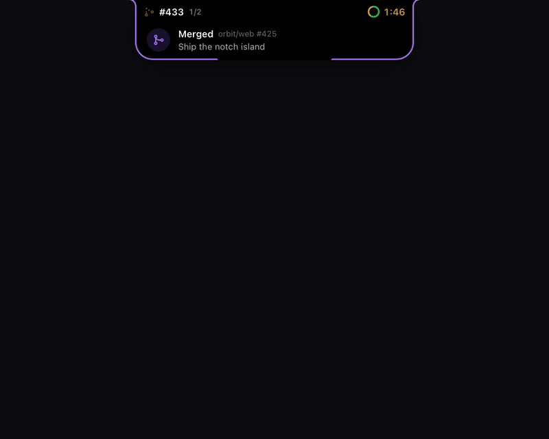
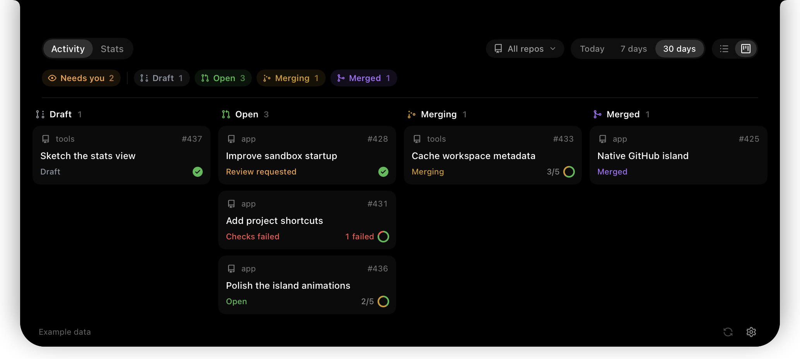
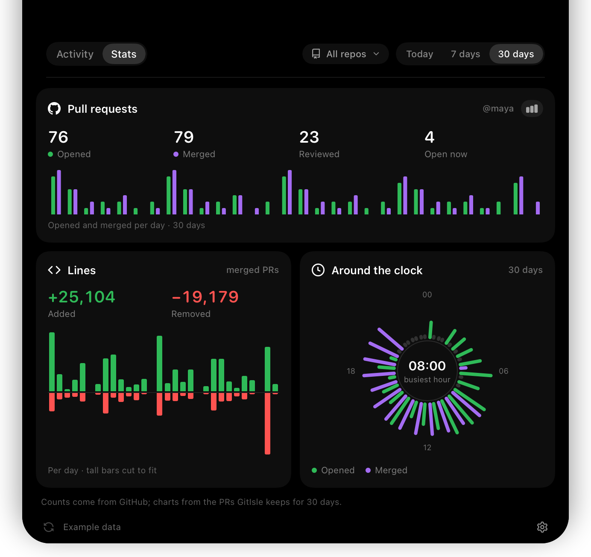

<p align="center">
  
</p>

<h1 align="center">GitIsle</h1>

<p align="center">
  Your pull requests, in the notch.
</p>

<p align="center">
  <a href="https://github.com/ppazosp/gitisle/actions/workflows/check.yml"></a>
  <a href="LICENSE"></a>
  
  
</p>

<p align="center">
  
</p>

GitIsle is a native macOS app that turns your Mac's notch into a live view of
your GitHub pull requests. It stays invisible until something happens, then
shows what's merging, which checks are running, and what needs you.

- **Invisible at rest.** With nothing going on, the island is just the notch.
- **Live work.** While your PRs merge or run checks, the island shows their
  number and a timer or check progress, taking turns when there are several.
  Click it to open the PR.
- **Banners.** PRs you open (ready or draft), drafts marked ready for review,
  your PRs becoming ready to merge or starting to merge, preview deploys
  becoming ready, merges, failed checks, and review requests slide out of the
  notch, one at a time, their time traced on the island's edge. Click one to
  open the PR, or the preview.
- **Inbox.** Open the island and they're waiting: new ones land on top with
  what to do next, and stay until you dismiss them or clear them all.
- **Checks at a glance.** Rest on a check ring to see which checks are running,
  passed, or failed, the merge queue's too, and click one for its log.
- **Activity.** Hover to open your PRs by repository, or as a board of GitHub
  states: draft, open, merging, merged. Filter by state, by what needs you,
  by repository, and by today, 7 days, or 30 days.
- **Stats.** PRs opened, merged, and reviewed, plus local Claude Code, Codex,
  and Pi token usage and estimated cost from local history, as bars, lines, areas, or running totals.

GitIsle only reads from GitHub. It never merges, reviews, comments, or marks
notifications as read.

<p align="center">
  
</p>

## Install

GitIsle needs macOS 14 or later and the [GitHub CLI](https://cli.github.com/),
signed in:

```sh
brew install gh && gh auth login
```

Then pick one:

**Homebrew**

```sh
brew install --cask ppazosp/gitisle/gitisle
```

The cask lives in [ppazosp/homebrew-gitisle](https://github.com/ppazosp/homebrew-gitisle),
and installs the GitHub CLI too if you don't have it.

**Install script**

```sh
curl -fsSL https://gitisle.ppazosp.dev/install.sh | bash
```

It downloads the latest release into Applications. The site serves
[`scripts/install.sh`](scripts/install.sh) from this repository, so you can read
exactly what runs.

**Download**

Get `GitIsle.dmg` from the [latest release](https://github.com/ppazosp/gitisle/releases/latest),
open it, and drag GitIsle into Applications.

**From source** (needs Xcode 26 or later)

```sh
git clone https://github.com/ppazosp/gitisle.git
cd gitisle
bash scripts/install.sh --from-source
```

> [!NOTE]
> GitIsle is free and isn't notarized by Apple, which needs a paid developer
> account. The install script and the Homebrew cask clear macOS's download
> quarantine for you, so the app just opens. If you install from the DMG and
> macOS says it can't be opened, open **System Settings → Privacy & Security**,
> scroll to the message about GitIsle, and click **Open Anyway** (on macOS 14,
> you can also right-click GitIsle in Applications and choose **Open**). Or run
> `xattr -dr com.apple.quarantine /Applications/GitIsle.app`.

To uninstall, quit GitIsle (right-click the island), then delete
`/Applications/GitIsle.app` and `~/Library/Application Support/GitIsle`.

## Use it

| To | Do |
| --- | --- |
| Open the island | Hover the notch for a moment, or click it |
| Open a live or announced PR | Click the top row or the banner |
| See a PR's checks, errors, reviews, and files | Click it in Activity; ⌘-click opens GitHub |
| Share a merged PR | Right-click it, or use Share on its page, to copy or save a card with its stats |
| Follow a stack of PRs | Stacked PRs sit together, each "on #N"; a PR's page shows its stack |
| Open a PR's preview deploy | Click its Preview chip (Vercel, Netlify, Railway, and other hosts that report to GitHub) |
| Switch between list and board | Use the toggle at the top right |
| Filter | Use the state chips, the repository picker, and Today / 7 days / 30 days. Pick one or more repositories; the live bar, banners, and notifications follow the picker too |
| Change settings | Click the gear, or right-click the island |
| Update GitIsle | Click the blue download button at the bottom right, when it shows |
| Quit | Right-click the island |

GitIsle works on Macs with a notch and on external displays. In Settings you
can choose the display, the hover delay, extra repositories to watch, system
notifications, which events to announce, launch at login, and euros or
dollars for costs.

<p align="center">
  
</p>

## How the numbers work

- **GitHub** checks for new and changed PRs every minute by default (every 2
  or 5 minutes in Settings) with one cheap query, and reads only the PRs that
  changed. Every search runs in full every 10 minutes. PRs with checks running,
  merging, or just updated refresh every 10 seconds, or every minute after 5
  minutes without keyboard or mouse input. While a PR is active this uses
  about 9% of your hourly GitHub API budget, and under 2% otherwise. On an
  error, the last snapshot stays on screen marked as cached.
- **Needs you** flags open PRs with a review request, failed checks, conflicts,
  requested changes, or that are ready to merge, behind, or blocked.
- **Claude Code and Codex usage** comes from the history files on your Mac,
  read by [CodexBar](https://github.com/steipete/CodexBar)'s usage library.
  Costs are estimates at API prices, separate from your subscription. To show
  euros, set the rate in Settings; GitIsle doesn't fetch exchange rates.

## Privacy

GitIsle talks to GitHub through your existing `gh` login, and loads avatars
from GitHub's avatar host. Installed releases check GitHub for a newer GitIsle
every hour and when your Mac wakes; updating downloads it from the release and
installs it only if it carries GitIsle's release signature. Usage statistics
never leave your Mac. There is no telemetry, account, or GitIsle server.
Settings and caches live in `~/Library/Application Support/GitIsle/`, and
GitIsle never writes to agent configuration, transcripts, or credentials.

## Contributing

Issues and pull requests are welcome. See [CONTRIBUTING.md](CONTRIBUTING.md)
for setup, preview flags, and checks, and [the architecture](docs/architecture.md)
for how it fits together. To report a security issue, see
[SECURITY.md](SECURITY.md).

## Credits and license

[CodexBar](https://github.com/steipete/CodexBar) provides the usage library.
[Agents Island](https://github.com/mustafahalabi/agents-island) provided the
notch geometry and window pattern, and [Magpie](https://github.com/fmguerreiro/magpie)
the idea of reusing the GitHub CLI login. Pull request icons are GitHub
[Octicons](https://github.com/primer/octicons); provider marks come from
[Simple Icons](https://simpleicons.org).

GitIsle is released under the [MIT license](LICENSE). See
[third-party notices](THIRD_PARTY_NOTICES.md).
