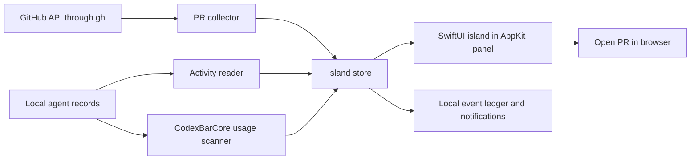

# Architecture

GitHub is the default view. Agent activity and statistics share a second tab.
The island window never starts an agent or performs a GitHub write.

`IslandCore` owns normalized PRs, activity records, GitHub queries, bounded
subprocess execution, and event comparisons. Its tests use local fixtures.
`GitIsle` owns the usage-library adapter, UI, settings, cache, and notifications.

Each collector runs independently. GitHub queries have a process deadline and
an output limit. A failed query leaves the previous snapshot available. The
collector checks missing open PR identities before treating them as merged or
closed. Unknown mergeability and successful checks alone never imply readiness.

The event ledger suppresses repeated notifications across launches. Initial
connection and account or repository changes establish a new baseline. A new
requested review can notify after that baseline. Failed-check notifications are
identified by PR and commit. Merge notifications use the observed merge time.

Codex desktop and CLI share the same history directory. Activity uses each
thread's identity rather than assigning one desktop process to one thread.
Claude subagent files do not replace the state of their parent session.
The usage scanner handles provider accounting, caches, and fork history.

The window targets a selected display. It uses a non-activating panel so hover
does not take keyboard focus. Mouse handling follows the visible island shape;
the rest of the transparent window passes clicks through. Full-screen visibility
is optional. The auto-hide menu bar can affect macOS full-screen detection;
enable Show in full screen if your menu bar is always hidden.

Caches and settings are local JSON files. Agent history stays in its existing
location. Changing a data source prevents an in-flight result from publishing
against the new selection.
