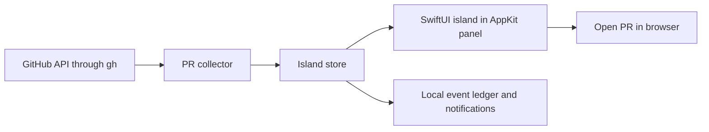

# Architecture

Activity is the default view: PRs grouped by repository, each showing its
state, or a board with one column per state, optionally limited to one
repository. Statistics have their own tab. The island window never starts an agent
or performs a GitHub write.

`IslandCore` owns normalized PRs, PR grouping by state and repository, time
windows, GitHub queries, bounded subprocess execution, event comparisons, and
the shipping statistics derived from merged PRs. Its tests use local fixtures.
`GitIsle` owns the UI, settings, cache, and notifications.

Each collector runs independently. GitHub queries have a process deadline and
an output limit. A failed query leaves the previous snapshot available. The
collector checks missing open PR identities before treating them as merged or
closed. Unknown mergeability and successful checks alone never imply readiness.

The PR collector reads GitHub three ways, to keep within the hourly GraphQL
budget that other `gh` tools share:

- **A check every minute.** One query lists the ID and last update of every
  PR the open-PR searches find, for one point in total. Only PRs that appeared,
  disappeared, changed, or moved between searches are read again, by ID.
- **A full search every 10 minutes**, and whenever there's nothing to compare
  against. It catches what doesn't touch a PR's update time, such as a base
  branch moving on, and covers searches too big for one check.
- **Active PRs by ID**, every 10 seconds: checks running, merging, or updated
  in the last 15 minutes. After 5 minutes without keyboard or mouse input this
  slows to once a minute.

The event ledger suppresses repeated notifications across launches. Initial
connection and account or repository changes establish a new baseline. A new
requested review can notify after that baseline. Failed-check notifications are
identified by PR and commit. Merge notifications use the observed merge time.

Statistics make no requests of their own. GitHub activity counts come from
one contributions query; time to merge, PR size and repositories are computed
from the merged PRs the collector already keeps for 30 days.

The island has four presentations: idle, which covers only the notch; live,
while your PRs merge or run checks; a temporary event banner; and expanded. One shape morphs between them with a spring; content fades in after
the shape starts growing and leaves before it shrinks. The expanded height
follows the measured content, and that measured size is also the hit-test area.
The store derives repository sections once per snapshot, so rendering never
re-filters the PR list. Collapsed repositories are remembered in user defaults.

The window targets a selected display. It uses a non-activating panel so hover
does not take keyboard focus. Mouse handling follows the visible island shape;
the rest of the transparent window passes clicks through. Full-screen visibility
is optional. The auto-hide menu bar can affect macOS full-screen detection;
enable Show in full screen if your menu bar is always hidden.

Caches and settings are local JSON files. Changing a data source prevents an
in-flight result from publishing against the new selection.
